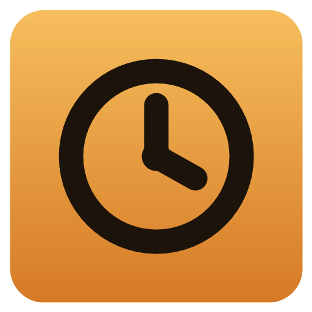
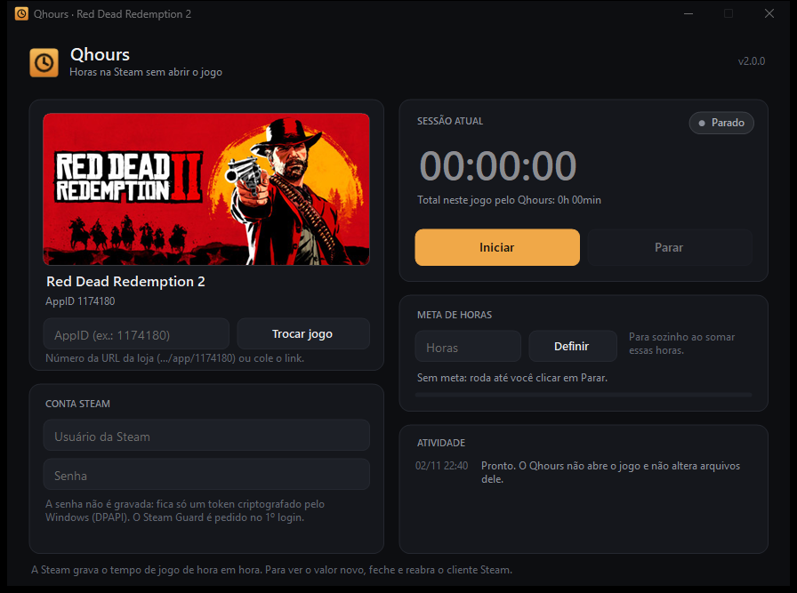

<p align="center">
  
</p>

<h1 align="center">Qhours</h1>

<p align="center">
  Registra horas de jogo na Steam <b>sem abrir o jogo</b>. App desktop leve para Windows (C# / .NET 8 + SteamKit2).
  <br>
  <a href="https://qhours.vercel.app"><b>Site</b></a> ·
  <a href="https://github.com/PQueirozDev/Qhours/releases/latest"><b>Baixar</b></a>
</p>

<p align="center">
  
</p>

## O que faz

O Qhours entra na sua conta Steam como um cliente à parte e avisa aos servidores que você está jogando o jogo escolhido (pelo AppID). A Steam conta esse tempo como tempo de jogo, como acontece com o ArchiSteamFarm.

- **Qualquer jogo da sua biblioteca:** digite o AppID ou cole o link da loja. O nome e a capa vêm da API pública da Steam.
- **Não abre o jogo** nem launchers (Rockstar, EA, Ubisoft) e não mexe em arquivos, saves ou conquistas.
- **Fica Offline** para os amigos. As horas contam mesmo assim.
- **Meta de horas:** para sozinho ao somar X horas.
- **Bandeja do sistema:** minimize e ele continua contando, com prioridade baixa e quase nenhuma CPU.
- **Pausa sozinho** se você abrir um jogo em outro PC ou no cliente Steam, e retoma 60 s depois que você fechar.

## Segurança

- A senha **nunca é gravada**. Ela fica só na memória até o login terminar.
- Depois do primeiro login (com Steam Guard: aprovação no celular ou código), fica salvo apenas um **token de sessão criptografado com DPAPI**. Só o seu usuário do Windows, neste PC, consegue ler.
- Os dados ficam em `%LOCALAPPDATA%\Qhours`. Para usar em modo portátil, crie uma pasta `dados` ao lado do `.exe`.
- Para revogar: botão **Esquecer conta**, e/ou Steam → Detalhes da conta → Gerenciar Steam Guard → *Desautorizar todos os outros dispositivos*.

## Como usar

1. Baixe o `Qhours.exe` em [Releases](https://github.com/PQueirozDev/Qhours/releases/latest). Não precisa instalar nem ter o .NET.
2. Escolha o jogo (padrão: Red Dead Redemption 2, AppID `1174180`).
3. Informe usuário e senha → **Iniciar** → confirme o Steam Guard.
4. Nas próximas vezes, basta clicar em **Iniciar**.

> A Steam grava o tempo de jogo **de hora em hora**. O cliente Steam só mostra o valor novo depois de ser fechado e reaberto, ou no seu perfil pelo navegador.

## Compilar

```powershell
dotnet build src/Qhours -c Release
# exe único, sem dependências:
dotnet publish src/Qhours -c Release -r win-x64 --self-contained -p:PublishSingleFile=true -p:EnableCompressionInSingleFile=true -o publish
```

O ícone é gerado por `tools/make-icon.ps1`, e o site fica em `site/` (HTML estático, publicado na Vercel).

## Estrutura

| Arquivo | Papel |
|---|---|
| `SteamService.cs` | Conexão, login com token, "jogando AppID", reconexão com recuo exponencial, pausa quando a conta é usada em outro lugar |
| `Storage.cs` | Configuração, totais por jogo e segredos com DPAPI |
| `GameInfo.cs` | Nome e capa do jogo (API da loja, com cache em disco) |
| `MainForm.cs`, `UiControls.cs`, `Theme.cs`, `Dialogs.cs` | Interface escura com controles desenhados à mão e suporte a DPI alto |

## Aviso

Projeto pessoal, sem afiliação com a Valve ou com os donos dos jogos. Use na sua própria conta e por sua conta e risco. Nomes e imagens de jogos pertencem aos respectivos donos.

## Licença

[MIT](LICENSE). Usa o [SteamKit2](https://github.com/SteamRE/SteamKit) (LGPL-2.1) e o protobuf-net (Apache-2.0).
